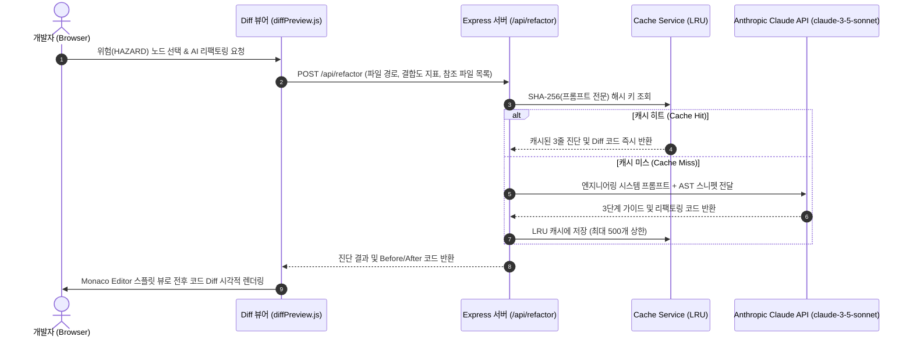

# AI 리팩토링 프롬프트 및 Before/After Diff 뷰어 명세 (AI & Diff Engine)

본 문서는 CodeDiagram(CodeRefactor) 시스템에서 고결합 위험(HAZARD) 노드를 진단하고 Monaco Editor 기반 Before/After Diff 뷰어로 수정 대안을 제시하는 AI 리팩토링 파이프라인 규격을 기술합니다.

---

## 1. 아키텍처 및 파이프라인 흐름

---

## 2. 3단계 AI 처방 프롬프트 구조 (Prompt Engineering)

주니어 개발자의 인지 부하를 줄이기 위해 장황한 설명을 배제하고 엄격한 3단계 포맷으로 답변을 제한합니다.

1. **[1단계] 결합도 진단 (Diagnosis):**
   - 왜 이 파일이 높은 원심 결합도($C_e$) 또는 $CBO$를 갖게 되었는지 구조적 원인을 1문장으로 요약.
2. **[2단계] 분리 대상 식별 (Separation Target):**
   - 현재 파일이 지나치게 많이 쥐고 있는 책임 중 외부로 분리해야 할 구체적인 클래스/메서드/인터페이스 지정.
3. **[3단계] 리팩토링 방향 (Refactoring Direction):**
   - 의존 역전 원칙(DIP) 또는 인터페이스 분리 원칙(ISP)을 적용한 구체적인 아키텍처 개선안 제시.

---

## 3. Before/After Monaco Diff 뷰어 연동 (`diffPreview.js`)

10주차 중간발표 심사위원의 강력 권고에 따라 정식 구현된 기능입니다.

* **스플릿 뷰 (Side-by-Side View):**
  - 좌측: 기존 레거시 코드 (수정 대상 영역 하이라이트).
  - 우측: AI가 리팩토링을 적용한 클린 코드 (추가/수정/삭제 라인 색상 대조).
* **토큰 최적화 및 핀포인트 추출:**
  - 전체 파일이 아닌 결함이 집중된 함수 및 클래스 선언부 스니펫(300~500 토큰)을 선별 전송하여 API 과금을 최소화하고 응답 속도를 극대화합니다.
* **장애 대응 Mock Provider 폴백:**
  - 외부 API 단절, 네트워크 타임아웃, 또는 API 키 미설정 환경에서도 시스템 백화(White-out) 없이 0.05초 내에 사전 정의된 표준 리팩토링 Diff 샘플을 자동 반환하여 100% 무중단 동작을 보장합니다.
