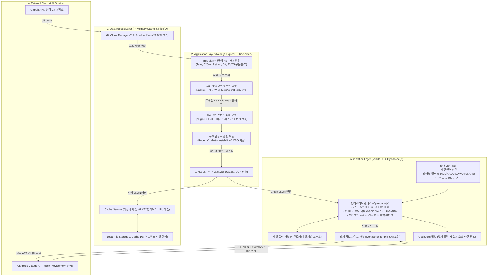

# 시스템 아키텍처 및 데이터 파이프라인 (Architecture & Pipeline)

본 문서는 CodeDiagram(CodeRefactor) 시스템의 계층형 아키텍처 구조와 소스코드 수집부터 인터랙티브 시각화, AI 리팩토링으로 이어지는 엔드투엔드(E2E) 데이터 파이프라인 규격을 기술합니다.

---

## 1. 아키텍처 개요 및 계층 구조 (Layered Architecture)

본 시스템은 Presentation, Application, Data Access, External Cloud의 4대 계층으로 엄격히 분리된 클린 아키텍처(Clean Architecture)를 따릅니다.

---

## 2. 5단계 엔드투엔드 데이터 파이프라인 (Data Pipeline)

소스코드 URL 입력부터 사용자 브라우저 렌더링 및 AI 진단까지의 데이터 변환 흐름입니다.

### [Step 1: 저장소 수집 및 캐시 검증]
1. 사용자가 웹 상단 바에 GitHub 저장소 URL 또는 로컬 프로젝트 경로를 입력합니다.
2. `Git Clone Manager`(`gitService.js`)가 URL 유효성을 검증(HTTPS 화이트리스트, 심볼릭 링크 차단)하고 임시 Shallow Clone을 수행합니다.
3. 동일 커밋의 분석 이력이 `Cache Service`(`cacheService.js`)에 존재할 경우, 파싱 과정을 건너뛰고 캐시된 `Graph JSON`을 1초 내에 즉시 반환합니다.

### [Step 2: Tree-sitter 다국어 AST 파싱 및 경계 격리]
1. `Tree-sitter AST 파서`(`parser.js`)가 소스파일을 순회하며 함수, 클래스, 임포트, 메소드 호출 관계를 정적 추출합니다.
2. 7대 주요 언어 규격 지원: Java, C/C++, Python, C#, TypeScript, JavaScript, HTML/CSS.
3. **1st-Party 벤더 필터링:** 외부 프레임워크(`node_modules/`, `Assets/Plugins/`, `vendor/` 등)를 자동 감지하여 노드 속성에 `isPlugin: boolean` 및 `isFirstParty: boolean` 플래그를 부여합니다.

### [Step 3: 로버트 C. 마틴 결합도 산출 및 3단계 판정]
1. `Dependency Resolver`가 노드 간의 참조 관계를 통해 구심 결합도($C_a$)와 원심 결합도($C_e$)를 집계합니다.
2. **공인 결합도 수식 적용:**
   - **노드 크기 (Coupling Between Objects):** $CBO = C_a + C_e$
   - **불안정성 지수 (Instability):** $I = \frac{C_e}{C_a + C_e} \quad (C_a + C_e = 0\text{인 고립 노드는 } I = 0)$
3. **소수 법칙 왜곡 방지:** $CBO < 5$인 경량 컴포넌트는 비율 왜곡을 막기 위해 $I$ 값과 무관하게 `SAFE` 구역으로 보호합니다.
4. **결합도 등급 판정:**
   - $CBO \ge 10$ 및 $I > 0.7$: **`HAZARD` (위험 - 적색)**
   - 중간 규모 또는 $I > 0.4$: **`WARN` (주의 - 황색)**
   - 소형 컴포넌트 또는 안정 모듈: **`SAFE` (안전 - 녹색)**

### [Step 4: 인터랙티브 시각화, 복잡도 완화 및 로컬 포커스]
1. `Graph Schema Normalizer`(`graphBuilder.js`)가 Cytoscape.js 규격의 `elements.nodes` 및 `elements.edges` JSON으로 변환합니다.
2. **초기 화면 복잡도 완화:** 파일 트리 폴딩 시 하위 노드를 캔버스에서 제외 마스킹하고, 상단 상태 필터 칩(`ALL`, `HAZARD`, `WARN`, `SAFE`, `N/A`)으로 관심 등급만 즉시 필터링합니다.
3. **로컬 포커스 뷰:** 위험 노드 클릭 시 상·하위 의존성 이웃만 캔버스에 확대 격리 렌더링합니다.

### [Step 5: Claude AI 리팩토링 및 Monaco Before/After Diff 렌더링]
1. 사용자가 위험 노드를 클릭하면 `aiService.js`가 해당 노드의 함수 단위 AST 스니펫(300~500 토큰)을 추출합니다.
2. Anthropic Claude API와 연동하여 (1) 결함 원인 진단, (2) 분리 대상 식별, (3) 리팩토링 방향의 3단계 가이드를 도출합니다.
3. `diffPreview.js`가 Monaco Editor 기반 스플릿 뷰를 열어 기존 코드와 리팩토링 제안 코드를 시각적 Diff로 즉시 렌더링합니다.
4. 외부 네트워크 장애 대비 0.05초 즉시 반환 Mock Provider 폴백 및 SHA-256 프롬프트 해시 기반 인메모리 LRU 캐시(상한 500개)가 작동합니다.
