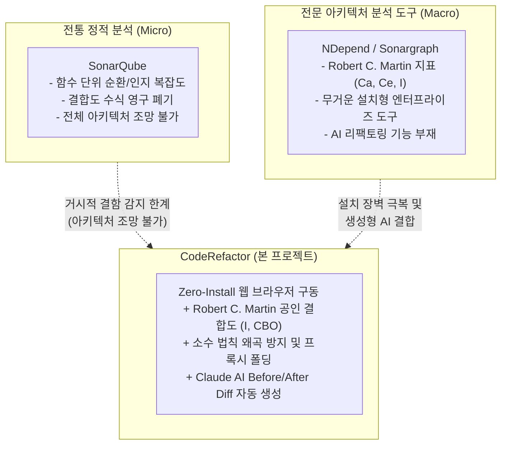

# 정적 분석 도구(SonarQube) 대비 비교 분석 (Comparative Analysis)

본 문서는 업계 대표 정적 분석 도구(SonarQube) 및 전문 아키텍처 분석 도구(NDepend, Sonargraph 등)와 CodeDiagram(CodeRefactor) 간의 결합도 및 아키텍처 결함 감지 메커니즘을 심층 비교 분석합니다.

---

## 1. 개요 및 비교 배경

* **SonarQube의 한계:** SonarQube는 개별 파일 및 함수의 구현 품질(Clean Code, 복잡도, 보안 취약점) 등 **미시적(Micro) 코드 스멜**에 집중하면서, 과거 지원하던 패키지 결합도 공식($C_a, C_e, I$) 계산을 의도적으로 영구 폐기하였습니다.
* **아키텍처 전문 도구의 한계:** NDepend, Sonargraph, Structure101 등은 정밀한 거시적 결합도 공식을 지원하지만, 무거운 온프레미스 설치가 필수적이고 AI 리팩토링 기능이 부재합니다.
* **CodeRefactor의 포지셔닝:** 공인 소프트웨어 공학 결합도 지표와 2D 인터랙티브 캔버스 시각화, 그리고 Claude AI 기반 Before/After Diff 생성을 **웹 브라우저 탭 하나(Zero-Install)**로 제공합니다.

---

## 2. 도구별 정밀 기능 대조표

| 비교 항목 | SonarQube | NDepend | CodeScene | **CodeRefactor (본 프로젝트)** |
| :--- | :--- | :--- | :--- | :--- |
| **분석 관점** | 미시적 코드 품질 (Clean Code) | 거시적 아키텍처 및 결합도 | 형상관리 변경 이력 결합도 | **거시적 아키텍처 + AI 리팩토링** |
| **결합도 수식** | **미지원** (공식 폐기, 30개 초과 단일 룰) | $C_a, C_e, \text{Instability } I, D$ | Churn $\times$ Complexity (통계) | **$C_a, C_e, I, CBO$ + 소수 왜곡 보호** |
| **시각화 방식** | 텍스트 대시보드 위주 | 2D 매트릭스 / DSM 그래프 | 코드 시티(3D 인터랙티브) | **Cytoscape.js 2D 계층형 캔버스** |
| **설치 환경** | 전용 서버 및 에이전트 설치 필수 | Visual Studio 플러그인 / 로컬 앱 | 클라우드 SaaS / 엔터프라이즈 서버 | **웹 브라우저 즉시 구동 (Zero-Install)** |
| **외부 노이즈 격리** | 단순 린트 제외 규칙 | 어셈블리 필터링 | Git 이력 기반 필터링 | **1st-Party 벤더 필터링 & 프록시 폴딩** |
| **리팩토링 지원** | 규칙 위반 가이드 텍스트 제공 | 규칙 위반 라인 점프 | 위험 영역 핫스팟 경고 | **Claude AI 3줄 진단 + Monaco Diff** |

---

## 3. 핵심 차별화 가치 요약

1. **숲(Architecture)과 나무(Code)의 동시 조망:**
   - 단순 줄 단위 린트에 머무르지 않고, 전체 시스템의 패키지·클래스 간 의존 위험을 신호등(SAFE/WARN/HAZARD)으로 한눈에 파악합니다.
2. **진단에서 해결까지 단일 파이프라인:**
   - 결함 수치만 나열하고 끝나는 기존 도구와 달리, 위험 노드 클릭 한 번으로 AI가 구체적인 인터페이스 분리 및 DIP 패턴 수정 코드를 전후 비교(Diff)로 즉각 제시합니다.
3. **설치 없는 즉각적 접근성:**
   - GitHub URL 또는 로컬 경로 입력만으로 3초 내에 인터랙티브 캔버스가 구동되어 도입 장벽이 전혀 없습니다.
