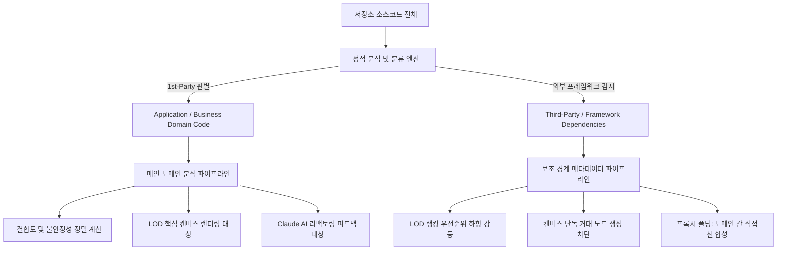

# 1st-Party 벤더 필터링 및 프록시 폴딩 (Proxy Folding & LOD)

본 문서는 실무 프로젝트 분석 시 발생하는 외부 라이브러리의 결합도 독점 문제와 화면 왜곡(LOD 왜곡)을 해결하기 위한 1st-Party 벤더 필터링 및 프록시 폴딩(Proxy Folding) 알고리즘 규격을 기술합니다.

---

## 1. 문제 제기: 외부 라이브러리의 결합도 독점 현상

실전 프로젝트(Unity 게임 엔진, Spring 백엔드, React 웹 등) 분석 시 개발자가 직접 작성한 비즈니스 도메인 코드보다 외부 프레임워크 라이브러리가 결합도를 독점하는 치명적 왜곡이 발생합니다.

### 1.1 핵심 문제점
1. **외부 모듈의 결합도 독점**:
   - Unity의 `TextMeshPro(TMP)`, Spring의 `Controller`/`Service`, Node.js의 거대 유틸리티 모듈은 수많은 사용자 클래스로부터 인입 결합($C_a$)을 흡수합니다.
   - 결과적으로 외부 모듈의 결합도($CBO$)가 사용자 핵심 비즈니스 코드보다 압도적으로 높게 측정됩니다.
2. **LOD(Level of Detail) 알고리즘과의 악순환**:
   - 복잡도 완화를 위해 고결합도 노드 위주로 축약 렌더링할 때, 정작 화면 중심에는 `TextMeshPro` 같은 외부 모듈만 거대하게 남고 **개발자가 직접 작성한 핵심 도메인 코드는 소멸**되는 주객전도 현상이 발생합니다.
3. **`.gitignore` 방식의 한계**:
   - 벤더 코드나 에셋 패키지가 저장소에 직접 커밋(Vendoring)되는 경우가 빈번하여 단순 Git 제외 규칙만으로는 걸러낼 수 없습니다.

---

## 2. 1st-Party 경계 격리 파이프라인 (Isolation Pipeline)

NDepend, Sonargraph 등 엔터프라이즈 정적 분석 도구의 격리 원칙을 준용하여, 소스코드 내 모든 노드를 **도메인 코드**와 **외부 의존성**으로 엄격히 분리합니다.



---

## 3. 프록시 폴딩 (Proxy Folding) 알고리즘

외부 라이브러리를 거쳐가는 간접 호출을 사용자 도메인 클래스 간의 직접 참조선으로 합성 축약하여 아키텍처의 본질을 보존합니다.

```
[기존 간접 호출]
[UserClass A] ──호출──> [External Framework / Helper] ──호출──> [UserClass B]

[프록시 폴딩 적용 후 (Plugin OFF)]
[UserClass A] ═════════(직접 의존 관계 합성)═════════> [UserClass B]
*(외부 라이브러리 노드는 캔버스에서 마스킹되고 직접선으로 축약)*
```

### 3.1 구현 효과
* **도메인 순수성 회복:** 화면 중심에 비즈니스 클래스 간의 상호 작용만 깔끔하게 시각화됩니다.
* **LOD 왜곡 원천 차단:** 외부 프레임워크가 결합도를 독식하여 사용자 코드가 숨겨지는 현상이 방지됩니다.
* **원클릭 복원:** 필요한 경우 상단 툴바 토글을 통해 외부 라이브러리 전체 호출 관계를 다시 펼쳐볼 수 있습니다.
