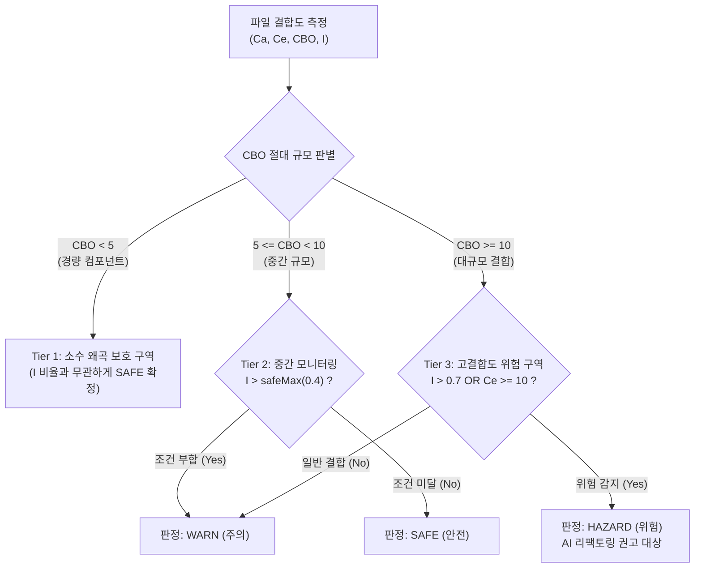

# 결합도 메트릭 산출 규격 및 소수 법칙 왜곡 방지 (Metrics Specification)

본 문서는 CodeDiagram(CodeRefactor) 엔진의 소프트웨어 공학적 결합도 메트릭 산출 공식과, 실제 분석 시 발생하는 소수 법칙 왜곡을 방지하기 위한 3단계 계층형 판정 체계(3-Tier Architecture) 규격을 기술합니다.

---

## 1. 배경 및 문제 제기 (Law of Small Numbers)

단순 백분율 기반의 불안정성 공식($I = \frac{C_e}{C_a + C_e}$)을 무비판적으로 적용할 경우, 의존 관계의 절대 규모가 작은 경량 컴포넌트에서 비정상적인 결함 오분류가 발생합니다.

### 1.1 현상 관찰 사례
* **대상 컴포넌트:** `TransformGizmo.cs`
* **측정 지표:** 외부 참조 $C_e = 2$, 피참조 $C_a = 1$, 총 결합도 $CBO = 3$
* **불안정성 산출:** $I = \frac{2}{1 + 2} \approx 66.7\%$
* **단순 백분율 판정의 문제:** 총 의존성이 고작 3개에 불과한 소형 파일임에도 비율만 보고 `WARN` 경고를 발령하여 개발자에게 불필요한 인지 피로를 초래함.

### 1.2 소수 법칙의 오류 (Tversky & Kahneman, 1971)
표본 크기($N = CBO$)가 충분하지 않을 때 비율 척도를 그대로 해석하면 극단적인 수치가 빈번히 발생합니다.
따라서 **의존성의 절대적 규모($CBO$)와 상대적 비율($I$)을 결합한 다계층 판정 기준**이 필수적입니다.

---

## 2. 3단계 계층형 결합도 판정 체계 (3-Tier Architecture)

### 2.1 판정 계층 상세 규격

| 계층 (Tier) | CBO 범위 | 불안정성($I$) 조건 | 최종 판정 | 설계 의도 및 의미 |
| :--- | :--- | :--- | :--- | :--- |
| **Tier 1 (경량 보호)** | $CBO < 5$ | 전체 ($0.0 \sim 1.0$) | **`SAFE`** | 1~4개의 소수 의존성으로 인한 비율 왜곡을 원천 차단 |
| **Tier 2 (중간 모니터링)** | $5 \le CBO < 10$ | $I \le 0.4$ $I > 0.4$ | **`SAFE`** **`WARN`** | 의미 있는 결합도 규모에서 외부 의존성이 치우친 모듈 감지 |
| **Tier 3 (고결합도 위험)** | $CBO \ge 10$ | $I > 0.7$ 또는 $C_e \ge 10$ $I \le 0.7$ | **`HAZARD`** **`WARN`** | 시스템 아키텍처를 위협하는 고위험 모듈 선별 및 AI 리팩토링 유도 |

---

## 3. 학술적 및 산업 표준 근거 (Theoretical Grounding)

### 3.1 Chidamber & Kemerer (CK) 객체지향 메트릭
* Chidamber & Kemerer(1994)의 연구에 따르면, 결합도($CBO$)가 $0 \sim 4$인 클래스는 단일 책임과 낮은 결합도를 충족하는 우수 설계(Low Coupling)로 분류됩니다.
* 따라서 $CBO < 5$ 구간에 보호 임계치(`minCboWarn = 5`)를 설정하는 것은 소프트웨어 공학적으로 확립된 타당성을 갖습니다.

### 3.2 Robert C. Martin의 안정 의존성 원칙 (SDP)
* 로버트 C. 마틴의 Clean Architecture 패키지 설계 이론에서 $I = 1.0$은 '유연하고 쉽게 변경 가능한 구체 모듈(Concrete & Flexible)'을 의미합니다.
* UI 뷰 컴포넌트나 최상위 실행 스크립트는 본질적으로 $I \rightarrow 1$에 수렴해야 정상입니다.
* 결합도 규모가 작을 때의 높은 $I$ 값은 정상적인 설계 패턴이며, 대규모 결합($CBO \ge 10$)이 동반될 때만 위험(`HAZARD`)으로 다루는 것이 SDP 원칙에 정확히 부합합니다.
